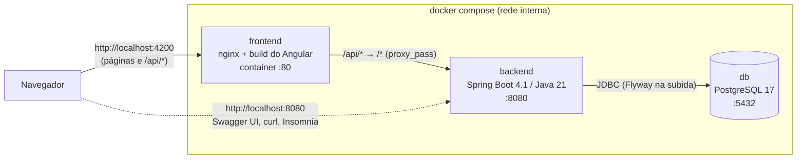
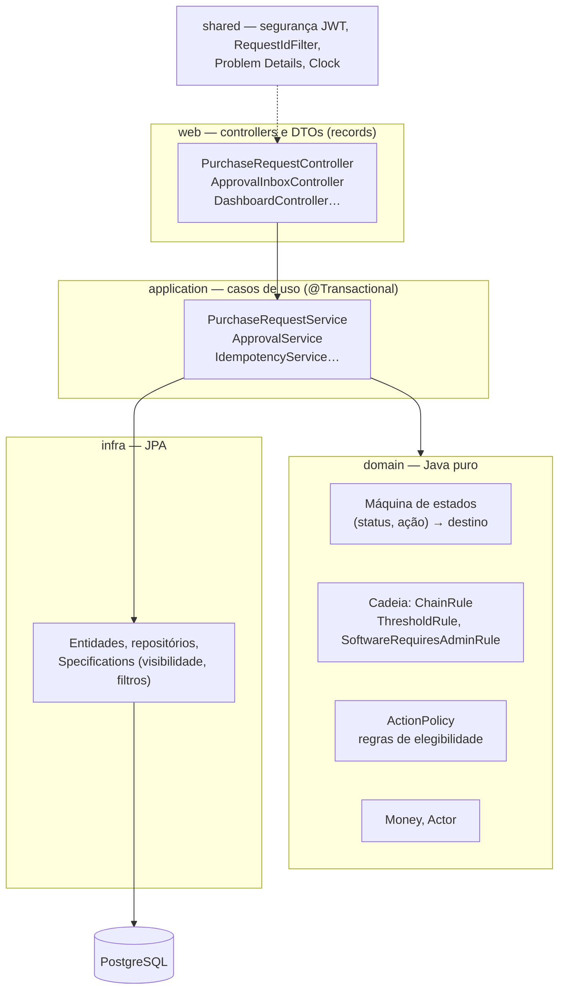
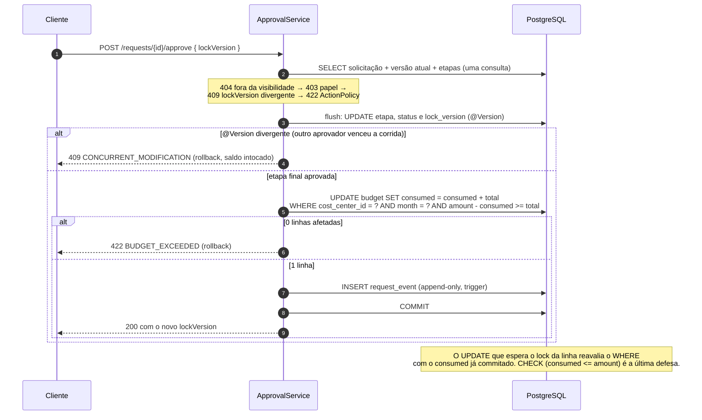
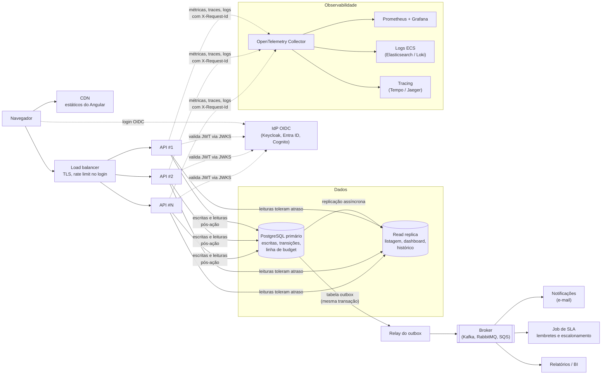

# Arquitetura

Este documento mostra a arquitetura **como está implementada** e uma **evolução possível** para escalar. As decisões em detalhe estão nos ADRs de [`docs/adr/`](adr/).

## Arquitetura atual

### Implantação (docker compose)

| Serviço | Porta no host | Porta no container | Health check |
|---|---|---|---|
| `frontend` | `4200` (`FRONTEND_HOST_PORT`) | `80` | `wget` em `/` |
| `backend` | `8080` (`BACKEND_HOST_PORT`) | `8080` | `curl` em `/health` (inclui o banco) |
| `db` | `5433` (`DB_HOST_PORT`) | `5432` | `pg_isready` |

A ordem de subida é garantida por `depends_on: condition: service_healthy`: `db` → `backend` (migrations + seed) → `frontend`.

### Camadas do back-end

Hexagonal pragmático com pacotes por feature (`request`, `budget`, `costcenter`, `user`, `dashboard`, `seed`, `shared`). O domínio é Java puro, e um teste ArchUnit impede que ele importe Spring ou JPA ([ADR 004](adr/004-arquitetura-do-dominio.md)).

A mesma `ActionPolicy` decide se a ação é permitida (`422`), monta o `allowedActions` do detalhe e filtra a caixa de aprovação; o front só renderiza o que ela devolve.

### Aprovação final: onde mora a garantia

As garantias de correção ficam **no banco**, não na memória da aplicação. Por isso o back-end é stateless e pode ter várias instâncias ([ADR 001](adr/001-concorrencia-e-orcamento.md)).

## Evolução de escalabilidade

### Ponto de partida

- **Back-end stateless:** a sessão é um JWT validado só com a chave ([ADR 007](adr/007-autenticacao-stateless.md)), e nenhuma regra depende de estado em memória. Lock otimista, UPDATE condicional, `UNIQUE(user_id, key)` da idempotência e o trigger do histórico vivem no PostgreSQL. Escalar horizontalmente é colocar mais instâncias atrás de um balanceador.
- **O gargalo é a linha de `budget`** de cada `(centro de custo, mês)`. Toda aprovação final daquele centro faz `UPDATE` na mesma linha, e o Postgres serializa esses UPDATEs pelo lock de linha, mantido até o commit. Com transações curtas isso aguenta bem o volume de um sistema de compras; o risco aparece com muitas aprovações simultâneas no mesmo centro, quando a latência sobe por espera de lock.
- **Outros limites conhecidos:** a caixa de aprovação filtra em memória e não é paginada; `idempotency_key` e `request_event` só crescem.

### Arquitetura alvo

### Passos, em ordem de custo/benefício

| Passo | O que muda | Cuidado |
|---|---|---|
| 1. **Load balancer + N instâncias** | Sem sticky session; o `X-Request-Id` gerado no LB atravessa toda a chamada. Rate limit no login no LB ou no gateway | O seed precisa de advisory lock (hoje a segunda instância falha na `UNIQUE` de e-mail num banco vazio) ou deve virar um job separado |
| 2. **Observabilidade** | Micrometer/Prometheus com métricas de negócio (aprovações, `409`, `BUDGET_EXCEEDED`, tempo de espera de lock), tracing com OpenTelemetry e logs ECS centralizados | É o que mostra **quando** a linha de budget virou gargalo, antes de qualquer otimização |
| 3. **Read replica** | Listagem, dashboard, histórico e versões leem da réplica (`@Transactional(readOnly = true)` roteado por um `DataSource` de leitura) | Atraso de replicação: o detalhe **depois de uma ação** (que traz o novo `lockVersion`) e a caixa de aprovação continuam no primário, senão o cliente recebe `409` por ler dado velho |
| 4. **Outbox + broker** | A transição grava um evento numa tabela `outbox` na **mesma transação**; um relay publica no broker. Notificações, SLA e BI viram consumidores | Entrega *at-least-once*: consumidores idempotentes, usando o id do evento |
| 5. **IdP (OIDC)** | Login, MFA, senha e desativação saem da aplicação; a API vira só Resource Server validando o JWT pela JWKS | Claims de papel e centro de custo vindas do IdP, ou lidas do banco a cada requisição, para fechar a janela de 15 min de perfil desatualizado |
| 6. **Aliviar a linha de budget** (só se as métricas pedirem) | Opções, da mais simples à mais complexa: manter a transação da aprovação final mínima; dividir o saldo do mês em N sub-linhas (*sharded counters*) e debitar de qualquer uma com saldo; reservar o valor no submit e só confirmar na aprovação; ou serializar as aprovações por centro de custo numa fila | Cada opção troca simplicidade por vazão; o UPDATE condicional atômico continua sendo a garantia de nunca ficar negativo |
| 7. **Crescimento de dados** | Particionar `request_event` por mês, job de limpeza de `idempotency_key` com mais de 24 h, caixa de aprovação paginada com o filtro da `ActionPolicy` traduzido para SQL | A tradução para SQL não pode divergir da `ActionPolicy`: manter testes que comparam os dois resultados |
