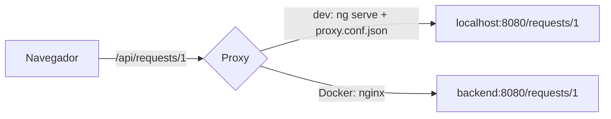

# Front-end — Solicitações de compra

SPA em **Angular 22** (componentes standalone, zoneless, signals) com Angular Material. Telas: login, dashboard, listagem com filtros na URL, formulário de criação/edição, detalhe com versões, cadeia e histórico, e caixa de aprovação. Visão geral e usuários do seed estão no [`SOLUTION.md`](../SOLUTION.md).

O front **não reimplementa regras de negócio**: os botões de ação vêm só do `allowedActions` do detalhe, o total do formulário é só exibição, e as mensagens de `422` mostram o `detail` da API.

## Pré-requisitos

- **Node.js 26** (mesma major do [`Dockerfile`](Dockerfile) e do CI) e o npm que vem com ele
- O back-end rodando em `http://localhost:8080` para usar a aplicação em desenvolvimento (ver [`backend/README.md`](../backend/README.md))

Não há variáveis de ambiente no front: ele sempre chama a API pela URL relativa `/api`.

## Comandos

Todos os comandos da tabela rodam na pasta **`frontend/`** e funcionam igual no bash, no cmd e no PowerShell.

| Comando                | O que faz                                                             |
| ---------------------- | --------------------------------------------------------------------- |
| `npm ci`               | Instala as dependências do `package-lock.json`                        |
| `npm start`            | `ng serve` em http://localhost:4200, com o proxy de `proxy.conf.json` |
| `npm test`             | Testes com Vitest, uma execução (não interativo, usado no CI)         |
| `npm run test:watch`   | Testes em modo watch                                                  |
| `npm run lint`         | angular-eslint                                                        |
| `npm run format`       | Prettier (escreve)                                                    |
| `npm run format:check` | Prettier (só verifica, usado no CI)                                   |
| `npm run build`        | Build de produção em `dist/frontend/browser`                          |

Para desenvolver com a stack mínima, abra três terminais.

1. Banco. Na **raiz do repositório**:

```bash
docker compose up -d db
```

2. API com o seed ligado. Na pasta **`backend/`**, use o comando do seu terminal.

bash (Linux, macOS, Git Bash):

```bash
SEED_ENABLED=true ./mvnw spring-boot:run
```

cmd:

```bat
set "SEED_ENABLED=true" && mvnw.cmd spring-boot:run
```

PowerShell:

```powershell
$env:SEED_ENABLED="true"; .\mvnw.cmd spring-boot:run
```

3. Front-end. Na pasta **`frontend/`**:

```bash
npm ci
```

```bash
npm start
```

Postgres em `localhost:5433`, API em `localhost:8080` e front em http://localhost:4200.

## Como o proxy `/api` funciona

O front chama sempre `/api/...` (constante `API_BASE_URL` em [`src/app/core/http/api.ts`](src/app/core/http/api.ts)). Os endpoints do back-end **não têm** esse prefixo, então quem está na frente remove o `/api` antes de encaminhar. Como o navegador só fala com a origem do front, não há CORS.



**Desenvolvimento (`npm start`):** o `angular.json` aponta o `ng serve` para o [`proxy.conf.json`](proxy.conf.json), que encaminha `/api` para `http://localhost:8080` com `pathRewrite: { "^/api": "" }`.

**Docker (`docker compose up --build`):** o [`Dockerfile`](Dockerfile) gera o build de produção e o serve com nginx. No [`nginx.conf`](nginx.conf), `location /api/` faz `proxy_pass http://backend:8080/;` — a barra final troca `/api/` por `/`, e `backend` é o nome do serviço na rede do compose. O nginx também:

- devolve o `index.html` para as rotas do Angular (`/requests/42`, `/approvals/inbox`), sem cache, para que um novo deploy seja percebido no próximo carregamento;
- guarda em cache por um ano os arquivos com hash no nome (`.js`, `.css`, fontes, imagens);
- repassa `X-Forwarded-For`/`X-Forwarded-Proto` ao back-end.

No compose, o nginx escuta na porta `80` do container, publicada em http://localhost:4200 (`FRONTEND_HOST_PORT`). O serviço só sobe depois que o back-end fica healthy, para evitar `502` nos primeiros acessos.

## Sessão e erros

- O token JWT fica no `sessionStorage`; os dados do usuário vêm de `GET /auth/me` após o login.
- Interceptors: `Authorization: Bearer`, `X-Request-Id` (UUID) em cada requisição e conversão de `application/problem+json` em um erro tipado. Um `401` limpa a sessão e volta ao login com `returnUrl`.
- `400` marca os erros nos campos do formulário (inclusive `items[0].quantity`); `409` avisa que a solicitação mudou e recarrega o detalhe; `422` mostra o `detail` da API perto da ação.
- O formulário de criação gera um `Idempotency-Key` por instância e o reaproveita em reenvios (duplo clique, retry).

## Testes

Os testes (Vitest + TestBed, `HttpClient` mockado com `provideHttpClientTesting`) verificam o que o usuário vê, entre eles:

- formulário: adicionar/remover itens recalcula o total; erros `400` aparecem no campo certo;
- detalhe: só os botões de `allowedActions` aparecem;
- tratamento de `409` (mensagem e recarga) e `422` (exibe o `detail`);
- interceptors, `returnUrl`, listagem, dashboard, caixa de aprovação e o pipe de valores em BRL.
